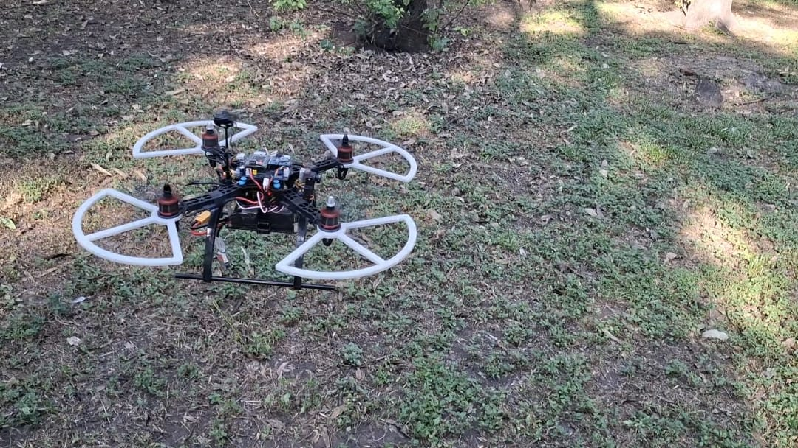
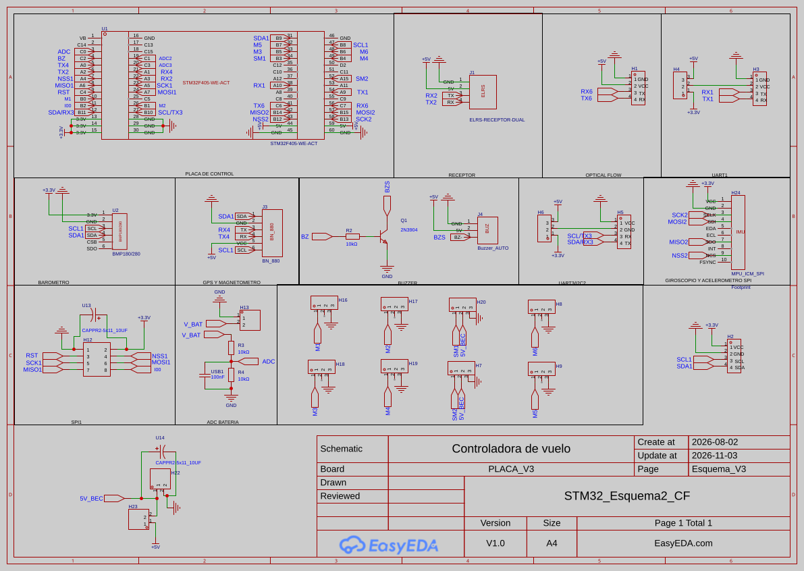

# Proyecto_CEREST
Diseño y desarrollo de un cuadricóptero capaz de reconstruir en tres dimensiones su entorno utilizando únicamente una cámara monocular, mediante técnicas de estimación de profundidad y de registro geométrico entre imágenes 2D.

# C.E.R.E.S.T.

Controlador de vuelo propio para cuadricóptero, desarrollado sobre un STM32F405RGT6,
con estimación de posición por flujo óptico, telemetría MAVLink y herramientas
en Python para calibración, sintonía y monitoreo.

Proyecto modular de Ingeniería Robótica — UDG CUCEI.



## Características

- Control en cascada: lazo de ángulo (P) y lazo de velocidad angular (PID).
- Filtro de orientación Mahony (IMU MPU6500 + magnetómetro QMC5883P).
- Estimación de posición con flujo óptico MTF-02P y modo de mantener posición.
- Telemetría MAVLink por ELRS: actitud, posición, GPS y batería.
- Lectura de voltaje y corriente con módulo de potencia tipo 3DR.
- Buzzer de aviso (inicialización y GPS listo) y buzzer de localización.

## Hardware

| Componente | Modelo | Conexión |
|---|---|---|
| Microcontrolador | STM32F4 | — |
| IMU | MPU6500 | SPI2 (CS en PB12) |
| Magnetómetro | QMC5883P | I2C1 |
| Barómetro | BMP180 | I2C1 |
| Flujo óptico + ToF | MicoAir MTF-02P | UART6 |
| GPS | BN-880 (u-blox M8) | UART4 |
| Radio | ExpressLRS (modo MAVLink) | UART2 |
| Motores | 2212 920 KV, hélices 8045 | TIM3 (PWM 250 Hz) |
| Servo | SG90 | TIM2 CH2 |
| Módulo de potencia | Tipo 3DR | PC1 (voltaje), PC3 (corriente) |
| Buzzer | JHE42B | PC2 (vía transistor NPN) |

## Diagrama eléctrico



## Canales del mando

| Canal | Función |
|---|---|
| 1–4 | Throttle, roll, pitch, yaw |
| 5 | Armado |
| 8 (switch SD) | Mantener posición |
| 10 | Servo |

## Estructura del repositorio

| Carpeta | Contenido |
|---|---|
| `Firmware_CEREST/` | Proyecto STM32 (CubeMX + CMake) |
| `Calibraciones/` | Scripts de calibración (acelerómetro en 6 posiciones + nivel, magnetómetro) |
| `Graficar/` | Captura y análisis de datos (sintonía PID, posición) |
| `Interfaz/` | Panel de control MAVLink (PIDs, IMU, posición, GPS, batería) |

## Herramientas en Python

Las herramientas (interfaz MAVLink, calibraciones y gráficas) requieren un
**entorno virtual de Python**: en Ubuntu 23.04 y posteriores, `pip` no permite
instalar paquetes directamente en el sistema.

### 1. Dependencias del sistema (una sola vez)

```bash
sudo apt install python3-venv python3-tk
```

### 2. Crear el entorno virtual (una sola vez)

Desde la raíz del repositorio:

```bash
python3 -m venv mavlink-env
```

### 3. Activar el entorno (cada vez que abras una terminal nueva)

```bash
source mavlink-env/bin/activate        # bash / zsh
source mavlink-env/bin/activate.fish   # fish
```

Al activarlo, la terminal muestra `(mavlink-env)` al inicio de la línea.

### 4. Instalar las librerías (una sola vez, con el entorno activo)

```bash
pip install -r requirements.txt
```

### 5. Ejecutar las herramientas

Con el entorno activo, por ejemplo:

```bash
python3 Interfaz/Mavlink_IGrafica_V2.py
```

Para salir del entorno virtual: `deactivate`.

## Licencia

